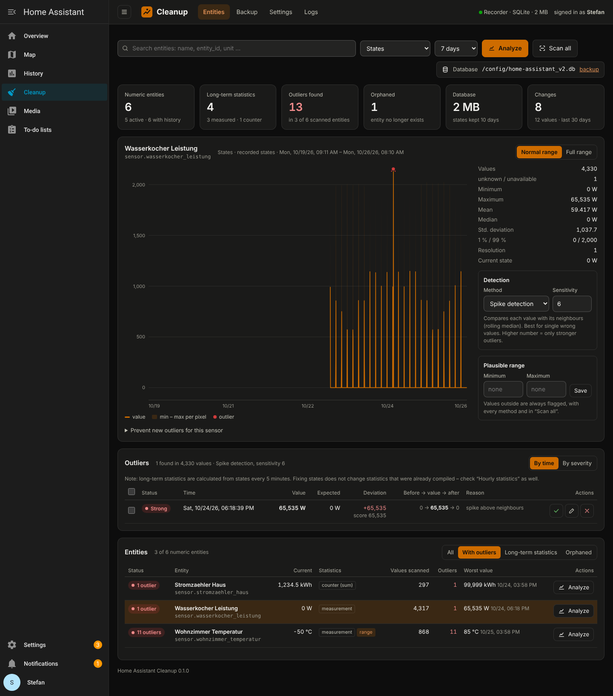
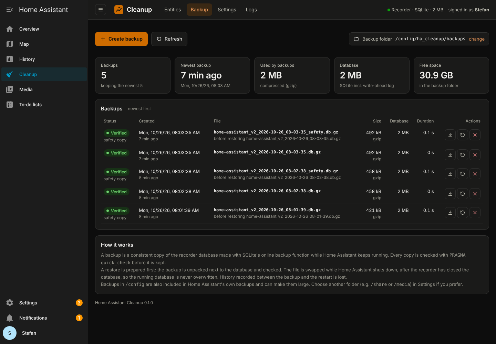

# Home Assistant Cleanup

A sidebar panel for Home Assistant that finds **outliers in recorded sensor values** – the single 85 °C reading from a temperature sensor, the 6553.5 % humidity spike, the energy counter that suddenly jumps by 400 kWh – and lets you **replace, edit or delete** them. It also **backs up and restores the recorder database**.



## Features

**Entities**
- Lists every entity with numeric values in the recorder (active, disabled, orphaned and long-term-statistics-only).
- Search by name, entity id, unit or device class; choose from the dropdown or the table.
- Overview per entity in an overlay that closes with ✕, Esc or a click outside: chart with outliers marked, min / max / mean / median / standard deviation, resolution and current state.
- Three data sources:
  - **States** – the raw history (kept for `purge_keep_days`, default 10 days).
  - **Hourly statistics** – long-term statistics, kept forever. This is what the energy dashboard and statistics graphs use.
  - **5-minute statistics** – short-term statistics.
- Detection methods:
  - **Spike detection** (default): compares every value with its neighbours (rolling median + MAD, a Hampel filter). Short glitches are found even on sensors with a daily cycle; longer runs (kettle on, heating phase) are treated as real events.
  - **IQR fences** and **Z-score** for global outliers.
  - **Plausible range**: your own min / max per entity, always applied.
- Actions per outlier: **replace with the expected value** (✓), **edit**, **delete**; bulk actions for a selection.
- Counters (`total_increasing`, energy): fixes are applied as a sum adjustment from that hour onward – the same thing *Developer tools → Statistics → Adjust sum* does.
- **Scan all** checks every entity and lists the ones with outliers first; the period is chosen right next to the button (default from the settings).
- **Automatic scan** daily or weekly with a **notification** (Home Assistant notification and/or a `notify.*` service such as the Companion app), optionally only about new outliers.
- **Orphaned entities** (deleted, but history still in the database) can be removed with the recorder's own purge functions, with a safety backup first.
- Snippets to prevent new outliers: Home Assistant `filter` sensor and ESPHome filters, prefilled from the analysis.

**Backup**
- Consistent online copy of the SQLite database (SQLite backup API, Home Assistant keeps running), gzip compression, `PRAGMA quick_check` on every copy, automatic rotation.
- Restore is safe: the backup is unpacked and verified next to the database, and the file is swapped **while Home Assistant shuts down, after the recorder has closed the database**. A safety backup of the current database is taken first.
- Download backups from the panel.

**Settings** – detection defaults, automatic scan and notification, scan period, limits, backup folder, compression, rotation, restore behaviour, plausible ranges.

## Automations

```yaml
# Run a scan whenever you like and react on the result
action: ha_cleanup.scan
data:
  notify: false
  days: 3
response_variable: result
```

The event `ha_cleanup_scan_finished` carries `outliers`, `new`, `with_outliers`, `entities` and `days`.

**Logs** – every change with old and new values, user and time. Edits and counter adjustments can be **undone**.



## Installation

### HACS (custom repository)
1. HACS → ⋮ → *Custom repositories* → add `https://github.com/YOUR_GITHUB_USER/ha-cleanup`, type **Integration**.
2. Install **Home Assistant Cleanup**, restart Home Assistant.
3. *Settings → Devices & services → Add integration → Home Assistant Cleanup*.
4. **Cleanup** appears in the sidebar (admin users only).

### Manual
Copy `custom_components/ha_cleanup` into `/config/custom_components/`, restart, then add the integration as above.

## Good to know

- **States vs. statistics.** Long-term statistics are compiled from states every 5 minutes. Fixing a state afterwards does not change statistics that were already compiled. Check *Hourly statistics* as well – that is where graphs and the energy dashboard read from.
- **The newest state of an entity cannot be deleted**, because the recorder links the next state to it. Edit it instead.
- **Deleting is final.** Replacing with the expected value keeps the timing of the history and can be undone in *Logs*. Make a backup before bigger clean-ups.
- **Backup folder.** Backups in `/config` are included in Home Assistant's own backups. Use `/share/…` or `/media/…` if you do not want that.
- **MariaDB / PostgreSQL.** Finding and fixing outliers works. Backup and restore need SQLite – use `mysqldump` / `pg_dump` instead.

## Requirements
Home Assistant 2025.3 or newer with the default recorder.

## License
MIT
